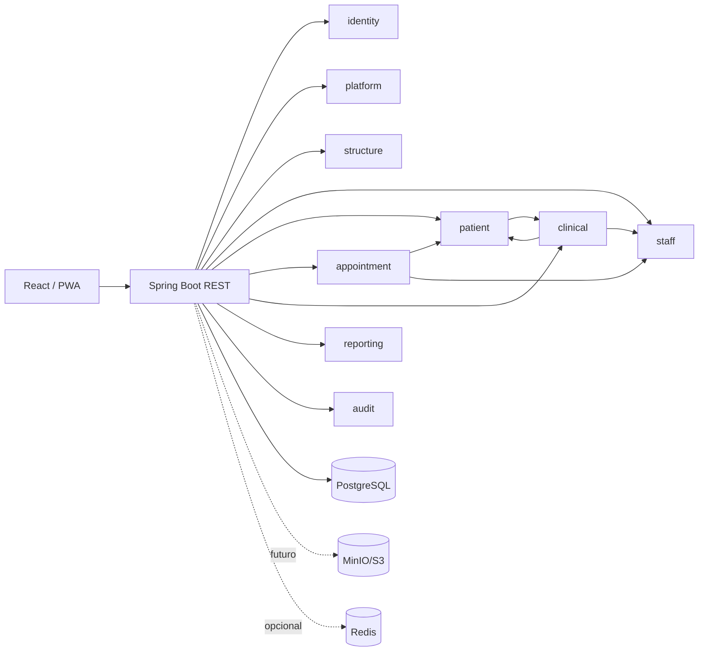

# Mapa de módulos ADENT

## Regla para ampliar
Cada nueva funcionalidad debe entrar dentro de un módulo existente o crear un módulo nuevo con `domain`, `repository`, `service` y `api`. Evitar controladores que accedan directamente a tablas de varios dominios.
